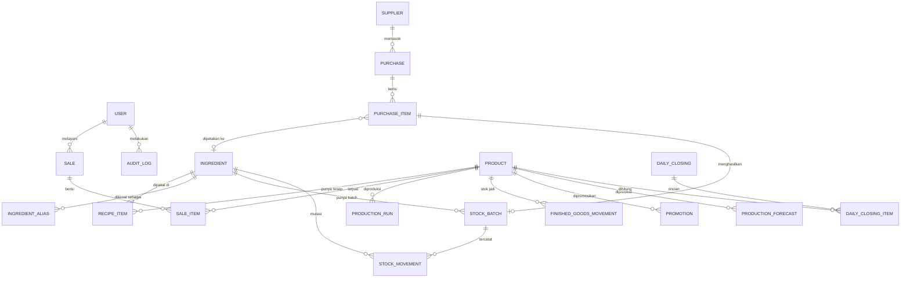

# ARCHITECTURE.md — Rencana Implementasi & Struktur Sistem

## 1. Tech Stack Overview

| Layer           | Teknologi                                                                               | Kegunaan                                                        |
| --------------- | --------------------------------------------------------------------------------------- | --------------------------------------------------------------- |
| Frontend        | Next.js (App Router) + React + TypeScript strict                                        | UI, routing, Server Components, Server Actions                  |
| Styling         | Tailwind CSS + shadcn/ui + lucide-react + sonner                                        | Komponen responsif, ikon, toast                                 |
| Backend         | Server Actions (mutasi UI) + Route Handlers (`/api/ai/*`, `/api/cron/*`, `/api/health`) | Logika server; Route Handler untuk upload, cron, health         |
| Domain logic    | Fungsi murni TypeScript di `src/server/domain` + `decimal.js`                           | HPP, FEFO, forecast, promo, konversi satuan (dites unit)        |
| Database        | PostgreSQL (Supabase sebagai host)                                                      | Data relasional dan transaksi                                   |
| ORM             | Prisma (koneksi pooled untuk runtime, direct untuk migrasi)                             | Akses DB bertipe, migrasi                                       |
| Auth            | Auth.js (Credentials, session JWT) + bcryptjs                                           | Login, sesi, RBAC OWNER/CASHIER                                 |
| Validasi        | Zod (+ react-hook-form)                                                                 | Validasi input dan output AI, satu skema untuk klien dan server |
| AI              | Gemini API via `@google/genai`, dibungkus adapter `AiProvider`                          | Baca foto nota (vision), teks promo/penjelasan/ringkasan        |
| Forecasting     | TypeScript murni (rata-rata tertimbang + koreksi newsvendor)                            | Prediksi produksi; AI hanya menjelaskan                         |
| Charts          | Recharts                                                                                | Grafik dashboard dan laporan                                    |
| Tanggal         | date-fns + date-fns-tz                                                                  | Perhitungan WIB / `businessDate`                                |
| Testing         | Vitest (+ Testing Library)                                                              | Unit, integrasi (DB test), tes konkurensi                       |
| CI              | GitHub Actions                                                                          | lint + typecheck + test + build pada PR                         |
| Scheduler       | Vercel Cron → `/api/cron/daily` (sekali sehari)                                         | Prediksi, alert, keep-alive DB, pembersihan                     |
| Deployment      | Vercel (app) + Supabase (DB)                                                            | Hosting live publik                                             |
| Package manager | pnpm                                                                                    | Dependency terkunci                                             |

### 1.1 Platform Constraints (verifikasi ulang di dokumentasi resmi sebelum final)

- **Supabase paket gratis** mem-pause project yang aktivitas databasenya rendah selama ±7 hari → wajib ada keep-alive (query nyata ke DB, tidak boleh di-cache) di cron harian. Paket gratis tidak menyediakan backup → jalankan `pg_dump` berkala dan sebelum demo.
- **Vercel Hobby:** durasi maksimum function default 10 detik (dapat dinaikkan hingga 60 detik → set `export const maxDuration` pada route AI); jumlah cron terbatas (gabungkan semua pekerjaan harian dalam satu job); project Hobby tidak dapat terhubung ke repo milik GitHub **organization** (taruh repo di akun GitHub salah satu anggota); penggunaan dibatasi non-komersial.
- **Gemini API paket gratis:** model teks/vision tertentu gratis dengan batas per proyek (HTTP 429 `RESOURCE_EXHAUSTED` bila terlampaui); data input/output dapat dipakai penyedia untuk perbaikan model → hanya kirim nota dummy/non-sensitif.

## 2. Project Directory Structure

```text
invensmart/
├─ AGENTS.md  PRD.md  ARCHITECTURE.md  TODO.md  SKILL.md  WORKFLOW.md
├─ README.md                    # setup, akun demo, env, arsitektur singkat
├─ .env.example                 # daftar env tanpa nilai rahasia
├─ vercel.json                  # definisi cron harian
├─ prisma/
│  ├─ schema.prisma
│  ├─ migrations/               # JANGAN diedit setelah diterapkan
│  └─ seed.ts                   # data demo ±6 bulan (idempoten)
├─ scripts/
│  └─ backtest.ts               # backtest forecast vs tanpa rekomendasi
├─ src/
│  ├─ app/
│  │  ├─ (auth)/login/page.tsx
│  │  ├─ (app)/                 # area terautentikasi (layout + nav sesuai peran)
│  │  │  ├─ dashboard/  pos/  products/  ingredients/
│  │  │  ├─ purchases/ (new, [id]/review)  production/  closing/
│  │  │  ├─ promotions/  reports/  settings/ (users, store)
│  │  ├─ r/[token]/page.tsx     # struk digital publik
│  │  └─ api/
│  │     ├─ ai/receipt/route.ts # upload nota → draft pembelian
│  │     ├─ cron/daily/route.ts # prediksi, alert, keep-alive (Bearer CRON_SECRET)
│  │     └─ health/route.ts
│  ├─ features/<feature>/       # actions.ts · queries.ts · schemas.ts · types.ts · components/
│  ├─ components/
│  │  ├─ ui/                    # shadcn/ui (hasil CLI)
│  │  └─ shared/                # DataTable, EmptyState, StatusBadge, Money, ConfirmDialog
│  ├─ server/
│  │  ├─ db.ts                  # Prisma client singleton
│  │  ├─ auth.ts                # konfigurasi Auth.js
│  │  ├─ rbac.ts                # requireRole(), assertOwnership()
│  │  ├─ rate-limit.ts          # berbasis tabel (AiLog/LoginAttempt)
│  │  ├─ domain/                # FUNGSI MURNI + tes: hpp, fefo, forecast, promo, units, money
│  │  └─ ai/                    # provider.ts (interface) · gemini.ts · prompts.ts · schemas.ts · matcher.ts · fallback.ts
│  ├─ lib/                      # env.ts (Zod env), date.ts (WIB), format.ts, action-result.ts, utils.ts
│  └─ types/
├─ tests/                       # integrasi (DB test) dan konkurensi
└─ docs/                        # diagram DB/arsitektur untuk proposal, skrip demo
```

| Folder/berkas     | Fungsi                                                                              |
| ----------------- | ----------------------------------------------------------------------------------- |
| `features/*`      | Satu folder per bounded feature; Server Action tipis yang memanggil `server/domain` |
| `server/domain/*` | Inti bisnis tanpa I/O; sumber kebenaran rumus; target cakupan tes ≥ 80%             |
| `server/ai/*`     | Semua interaksi AI terisolasi: adapter, prompt, skema output, fallback              |
| `lib/env.ts`      | Validasi env saat boot; aplikasi gagal start bila env wajib kosong                  |
| `prisma/seed.ts`  | Data demo berpola untuk juri dan backtest                                           |

## 3. Data Models / Database Schema

Konvensi: PK `cuid`; `createdAt`/`updatedAt` di semua tabel; uang = `Int` (Rupiah); kuantitas = `Decimal(14,3)`; biaya per satuan dasar = `Decimal(14,4)`; `businessDate` = `Date` (WIB) dihitung saat menulis; soft delete via `isActive` untuk entitas berhistori.

### 3.1 ER Diagram



### 3.2 Entitas

| Entitas                   | Field kunci (tipe)                                                                                                                                                                                                                                                                                | Catatan / constraint                                                                 |
| ------------------------- | ------------------------------------------------------------------------------------------------------------------------------------------------------------------------------------------------------------------------------------------------------------------------------------------------- | ------------------------------------------------------------------------------------ |
| **User**                  | id, name, email (unik, lowercase), passwordHash, role (`OWNER`/`CASHIER`), isActive                                                                                                                                                                                                               | Tanpa password plain; nonaktif = tidak bisa login                                    |
| **StoreSettings**         | id (singleton), storeName, targetMarginPct Int=50, overheadPerUnit Int=0, lowStockCoverDays Int=3, expiryAlertDays Int=3, maxPromoDiscountPct Int=30, minPromoMarginPct Int=0, promoStartTime "15:00", closingTime "22:00", timezone "Asia/Jakarta"                                               | Satu baris                                                                           |
| **Ingredient**            | id, name (unik ci), baseUnit (`G`/`ML`/`PCS`), currentCostPerBaseUnit Decimal(14,4), minStockQty Decimal, defaultShelfLifeDays Int?, packSizeInBase Decimal?, isActive                                                                                                                            | Harga = harga pembelian terakhir (responsif terhadap kenaikan pasar)                 |
| **IngredientAlias**       | id, ingredientId FK, aliasNormalized (unik), packUnit?, packSizeInBase?, source (`MANUAL`/`OCR_CONFIRMED`)                                                                                                                                                                                        | Memori pemetaan nama di nota → bahan                                                 |
| **Supplier**              | id, name, phone?, note?                                                                                                                                                                                                                                                                           | —                                                                                    |
| **Purchase**              | id, supplierId?, businessDate, source (`MANUAL`/`AI_RECEIPT`), status (`DRAFT`/`CONFIRMED`/`CANCELLED`), totalAmount Int, createdById, confirmedAt?                                                                                                                                               | `DRAFT` tidak memengaruhi stok                                                       |
| **PurchaseItem**          | id, purchaseId, ingredientId?, rawName, qty Decimal, unit String, qtyBase Decimal?, unitPrice Int, lineTotal Int, matchStatus (`EXACT`/`FUZZY`/`UNMATCHED`/`MANUAL`), matchScore Float?, flags String[]                                                                                           | Flag sanity check                                                                    |
| **StockBatch**            | id, ingredientId, purchaseItemId?, receivedAt, expiryDate Date?, qtyInitial, qtyRemaining, unitCost Decimal(14,4), status (`ACTIVE`/`DEPLETED`/`EXPIRED`/`DISCARDED`)                                                                                                                             | **CHECK (qtyRemaining >= 0)**; indeks (ingredientId, status, expiryDate, receivedAt) |
| **StockMovement**         | id, ingredientId, batchId?, type (`PURCHASE_IN`/`CONSUMPTION_SALE`/`CONSUMPTION_PRODUCTION`/`WASTE_EXPIRED`/`WASTE_SPOILED`/`ADJUSTMENT`/`SALE_VOID_RESTORE`), qtyDelta Decimal (+/−), unitCost, refType?, refId?, reason?, createdById?                                                          | Ledger append-only; indeks (ingredientId, createdAt), (refType, refId)               |
| **Product**               | id, name (unik), category, price Int, fulfillmentType (`MADE_TO_ORDER`/`PRE_PRODUCED`), yieldQty Int=1, shelfLifeDays Int=1, maxDailyCapacity Int?, isActive                                                                                                                                      | `shelfLifeDays` = 1 → sisa wajib dibuang saat tutup                                  |
| **RecipeItem**            | id, productId, ingredientId, qtyPerYield Decimal                                                                                                                                                                                                                                                  | **Unik (productId, ingredientId)**; resep per `yieldQty`                             |
| **ProductionRun**         | id, productId, businessDate, qty Int, note?, createdById                                                                                                                                                                                                                                          | Memotong bahan FEFO + menambah stok barang jadi                                      |
| **FinishedGoodsMovement** | id, productId, businessDate, type (`PRODUCED`/`SOLD`/`WASTE`/`ADJUSTMENT`/`SALE_VOID_RESTORE`), qtyDelta Int, refType?, refId?                                                                                                                                                                    | Stok barang jadi = Σ qtyDelta; indeks (productId, businessDate)                      |
| **Sale**                  | id, invoiceNo (unik), idempotencyKey (unik), businessDate, soldAt, cashierId, subtotal, discountTotal, total, paymentMethod (`CASH`/`QRIS`/`TRANSFER`), amountPaid, changeAmount, status (`COMPLETED`/`VOID`), voidReason?, voidedById?, voidedAt?, receiptToken (unik, ≥128-bit), customerPhone? | Indeks businessDate, soldAt                                                          |
| **SaleItem**              | id, saleId, productId, productName (snapshot), qty Int, listPrice Int, unitPrice Int, discountAmount Int, unitCostSnapshot Decimal(14,4), lineTotal Int, promotionId?                                                                                                                             | Snapshot HPP → laba historis akurat                                                  |
| **Promotion**             | id, productId, businessDate, discountPct Int, startsAt, endsAt?, source (`MANUAL`/`AI_SUGGESTED`), status (`ACTIVE`/`ENDED`/`CANCELLED`), copyText?, createdById                                                                                                                                  | —                                                                                    |
| **DailyClosing**          | id, businessDate (unik), status (`CLOSED`/`REOPENED`), closedById, closedAt, revenue Int, cogs Int, grossProfit Int, wasteValue Int, stockoutCount Int, summaryText?, summarySource (`AI`/`TEMPLATE`)?                                                                                            | Satu penutupan per tanggal                                                           |
| **DailyClosingItem**      | id, closingId, productId, produced Int, sold Int, expectedLeftover Int, countedLeftover Int, variance Int, action (`DISCARD`/`CARRY_OVER`), wasteValue Int                                                                                                                                        | —                                                                                    |
| **ProductionForecast**    | id, productId, forDate, recommendedQty Int, baseQty Decimal, zScore Decimal, dataPoints Int, confidence (`LOW`/`MEDIUM`/`HIGH`), explanation?, explanationSource?, generatedAt, acceptedQty Int?                                                                                                  | **Unik (productId, forDate)**                                                        |
| **Alert**                 | id, type (`LOW_STOCK`/`EXPIRING`/`EXPIRED`/`PRICE_SPIKE`/`MARGIN_LOW`), severity, refType, refId, message, dedupeKey (unik), readAt?                                                                                                                                                              | Dibuat cron/aksi; dedupe                                                             |
| **AiLog**                 | id, feature (`RECEIPT_OCR`/`FORECAST_EXPLAIN`/`PROMO_TEXT`/`DAILY_SUMMARY`/`RECIPE_DRAFT`), userId?, status (`SUCCESS`/`FALLBACK`/`ERROR`/`REJECTED`), model?, latencyMs, errorCode?                                                                                                              | **Tanpa payload**; juga dipakai untuk rate limit                                     |
| **AuditLog**              | id, userId, action, entity, entityId, before Json?, after Json?, createdAt                                                                                                                                                                                                                        | Void, adjust, ubah harga, reopen closing, ubah peran                                 |
| **LoginAttempt**          | id, email, ip, success, createdAt                                                                                                                                                                                                                                                                 | Rate limit login; indeks (email, createdAt)                                          |

### 3.3 RBAC Matrix

| Kemampuan                                      | OWNER | CASHIER |
| ---------------------------------------------- | ----- | ------- |
| POS, checkout, kirim struk                     | ✔     | ✔       |
| Catat produksi, tutup toko                     | ✔     | ✔       |
| Lihat stok (read-only)                         | ✔     | ✔       |
| Master data, resep, pengaturan, pembelian/nota | ✔     | ✘       |
| Void, adjust stok, reopen closing              | ✔     | ✘       |
| Dashboard keuangan, laporan, HPP/margin        | ✔     | ✘       |
| Kelola pengguna                                | ✔     | ✘       |

## 4. Implementation Phases

Aturan waktu: bila fase terlambat > 1 hari, **potong item P1 terbawah**, bukan P0. Setiap fase berakhir dengan deploy ke Vercel yang berfungsi.

### Phase 0 — Setup & Registrasi (15–18 Okt)

- Pastikan pendaftaran GTNIC (Gel. 3 berakhir 16 Okt); hadiri Technical Meeting 18 Okt dan catat ketentuan tambahan (template surat pernyataan, format Google Form).
- Scaffold Next.js + TS strict, Tailwind + shadcn/ui, ESLint/Prettier, Prisma + Supabase, validasi env, CI, deploy kerangka + `/api/health` + cron keep-alive.
- **AC:** URL Vercel live menampilkan halaman login kosong; `/api/health` mengembalikan 200 dan menjalankan query DB; CI hijau (lint, typecheck, test, build); cron terdaftar dan `CRON_SECRET` terpasang.

### Phase 1 — Fondasi & Master Data (19–21 Okt)

- Schema inti, Auth.js + RBAC + rate limit login, app shell, CRUD Ingredient/Product/Recipe, domain `money/units/hpp` + tes.
- **AC:** login OWNER/CASHIER berfungsi; CASHIER ditolak (403) mengakses halaman/aksi OWNER, termasuk saat memanggil Server Action langsung; HPP dan margin tampil benar untuk 5 menu uji (hasil sama dengan hitungan manual di tes); cakupan tes `domain/hpp|units|money` ≥ 80%.

### Phase 2 — Inventori & Pembelian Manual (22–24 Okt)

- Schema stok, domain `fefo`, form pembelian manual, halaman stok per batch, alert stok rendah/kedaluwarsa.
- **AC:** pembelian menambah batch dan memperbarui `currentCostPerBaseUnit`; HPP semua menu terdampak berubah ≤ 5 detik; FEFO memilih batch expiry terdekat (tes unit); stok tidak bisa negatif (tes + CHECK constraint); alert muncul tanpa duplikat.

### Phase 3 — POS & Auto-Deduct (25–28 Okt)

- UI POS tablet-first, status "Habis", checkout transaksional + idempotency, pembayaran, struk digital publik + `wa.me`, seed v1 (master + riwayat penjualan).
- **AC:** checkout 3 item ≤ 15 detik di tablet; stok bahan terpotong sesuai resep; dua checkout paralel pada stok terakhir → tepat satu berhasil (tes konkurensi); double-click tidak membuat transaksi ganda; `/r/[token]` dapat dibuka tanpa login dan tidak memuat PII.

### Phase 4 — Produksi, Tutup Toko, Dashboard, Seed (29 Okt–1 Nov)

- ProductionRun, stok barang jadi, tutup toko terpandu + penguncian, dashboard owner, seed v2 (produksi, sisa, limbah, lonjakan harga, kejadian kehabisan).
- **AC:** produksi memotong bahan FEFO dan menambah stok jadi; penutupan idempoten per tanggal dan memblokir penjualan sesudahnya; dashboard memuat < 2 detik pada data seed; `pnpm db:seed` dapat diulang tanpa duplikasi.

### Phase 5 — Fitur AI P0 (2–5 Nov)

(Adapter AI + OCR boleh dikerjakan paralel oleh anggota tim lain mulai Phase 2.)

- Adapter AI + Gemini, endpoint baca nota, matcher + layar review + alias learning, domain `forecast` + `backtest`, cron prediksi + kartu rekomendasi.
- **AC:** 5 foto nota uji (rapi, miring, tulisan tangan, buram, non-nota) menghasilkan perilaku benar (draf yang dapat diedit atau pesan error jelas); AI mati/429/JSON invalid → fallback form manual tanpa crash; tidak ada stok berubah sebelum konfirmasi; forecast mengikuti rumus §5.3 (tes unit) dan menampilkan confidence; `scripts/backtest.ts` menghasilkan tabel perbandingan sisa untuk proposal.

### Phase 6 — P1, Hardening & Polish (6–8 Nov)

- Promo sisa, ringkasan harian, draf restock, alert lonjakan harga, void, audit log, laporan + CSV, manajemen user; security pass, responsive QA, aksesibilitas, README.
- **AC:** checklist `SKILL.md §2` (security review) lulus; tidak ada `any`/`@ts-ignore`; Lighthouse performa/aksesibilitas dasar tercek; QA di Chrome, Firefox, Safari, Edge pada 360/768/1280 px; semua P0 tetap hijau di CI.

### Phase 7 — Pengumpulan (9–10 Nov)

- Proposal PDF (sesuai format lomba), video demo 3–5 menit (YouTube/Drive publik), surat pernyataan keaslian, set repo + website ke publik, `pg_dump`, submit Google Form.
- **AC:** semua tautan terbuka dari akun lain (mode incognito); berkas `GTNIC2026_WebDev_NamaTim.pdf` ≤ 15 halaman dan ber-logo GTNIC di cover; submit **≤ 10 Nov 18:00 WIB** (batas resmi 23:59).

### Phase 8 — Persiapan Final (11–14 Nov)

- Skrip pitching, data demo bersih, rekaman cadangan demo, uji koneksi Zoom + berbagi layar.
- **AC:** simulasi demo penuh 3 kali tanpa error; rencana B (video rekaman) siap.

## 5. Core Algorithms & AI Integration Design (Tambahan)

### 5.1 Pemotongan stok FEFO (dalam satu transaksi DB)

```ts
// Dipanggil dari dalam prisma.$transaction. Semua kuantitas = Decimal.
async function consumeIngredient(
  tx: Tx,
  ingredientId: string,
  need: Decimal,
  ref: Ref,
  todayWib: string,
) {
  // Kunci baris batch agar checkout paralel tidak menggandakan stok
  const batches = await tx.$queryRaw<Batch[]>`
    SELECT id, "qtyRemaining", "unitCost" FROM "StockBatch"
    WHERE "ingredientId" = ${ingredientId} AND "qtyRemaining" > 0
      AND ("expiryDate" IS NULL OR "expiryDate" >= ${todayWib}::date)
    ORDER BY "expiryDate" ASC NULLS LAST, "receivedAt" ASC
    FOR UPDATE`;
  let remaining = need;
  for (const b of batches) {
    if (remaining.lte(0)) break;
    const take = Decimal.min(b.qtyRemaining, remaining);
    // UPDATE batch (kurangi), set DEPLETED bila 0, INSERT StockMovement (qtyDelta = -take, unitCost = b.unitCost)
    remaining = remaining.minus(take);
  }
  if (remaining.gt(0))
    throw new InsufficientStockError(ingredientId, remaining); // rollback seluruh transaksi
}
```

Checkout: hitung kebutuhan semua bahan dari resep × qty (agregasi per bahan), panggil `consumeIngredient` per bahan, kurangi stok barang jadi untuk `PRE_PRODUCED`, tulis `Sale`/`SaleItem`, semuanya dalam satu transaksi. Idempotency key dicek di awal (unik).

### 5.2 HPP

```
costPerYield = Σ (RecipeItem.qtyPerYield × Ingredient.currentCostPerBaseUnit)
HPP per porsi = costPerYield / Product.yieldQty + StoreSettings.overheadPerUnit
margin% = (price − HPP) / price
```

Dihitung ulang saat `currentCostPerBaseUnit` berubah. `SaleItem.unitCostSnapshot` menyimpan HPP saat transaksi.

### 5.3 Prediksi produksi (statistik, bukan LLM)

Untuk menu `p`, tanggal target `D` (hari-minggu `w`):

1. Ambil hingga 8 hari operasional terakhir dengan hari-minggu `w`: `sold_i`, `produced_i`, `leftover_i`, urut dari terbaru (`i = 0`).
2. **Koreksi permintaan tersensor:** bila `leftover_i = 0` (kehabisan) maka `demand_i = sold_i × 1.10`, selain itu `demand_i = sold_i`.
3. `base = Σ(wᵢ·demandᵢ) / Σwᵢ` dengan `wᵢ = 0.8^i`; `σ` = simpangan baku `demandᵢ`.
4. `trend` = rata-rata permintaan 7 hari terakhir ÷ rata-rata 28 hari sebelumnya, di-clamp [0.9, 1.1] (1 bila data kurang).
5. **Newsvendor:** `CR = clamp((price − HPP) / (price − salvage), 0.2, 0.95)` dengan `salvage = 0` (sisa dibuang); `z = Φ⁻¹(CR)` (implementasi `inverseNormalCdf` di domain).
6. `recommended = clamp(ceil(base × trend + z × σ), 0, maxDailyCapacity)`.
7. `dataPoints` ≥ 8 → HIGH; 4–7 → MEDIUM; < 4 → LOW (fallback: rata-rata 14 hari terakhir).

Menu bermargin tinggi cenderung diproduksi lebih banyak, dan margin tipis lebih hemat, mengikuti logika ekonomi sisa produksi. Metode ini dapat dijelaskan dan dibuktikan lewat `scripts/backtest.ts`.

### 5.4 Promo sisa dagangan

```
floor      = HPP × (1 + minPromoMarginPct/100)
maxDisc    = min(maxPromoDiscountPct/100, 1 − floor/price)       // bila ≤ 0 → tidak ada diskon aman
projLeft   = stokSekarang − Σ penjualan se-hari-minggu setelah jam ini (rata-rata historis, dari SaleItem.soldAt)
tier waktu: 15:00 → 10%, 17:00 → 20%, 19:00 → 30%, masing-masing dibatasi maxDisc
```

Hanya menu dengan `projLeft` > ambang yang disarankan. LLM hanya menulis teks promo dari angka yang sudah final.

### 5.5 Adapter AI & pipeline baca nota

```ts
export interface AiProvider {
  extractReceipt(
    input: { image: Buffer; mimeType: string },
    opts: { signal: AbortSignal },
  ): Promise<unknown>; // divalidasi Zod setelahnya
  generateText(
    input: { task: AiTask; facts: Record<string, unknown> },
    opts: { signal: AbortSignal },
  ): Promise<string>;
}
```

Pipeline: kompres di klien → `POST /api/ai/receipt` (multipart) → autentikasi + RBAC (OWNER) → rate limit → validasi file (MIME, magic bytes, ukuran) → `extractReceipt` (timeout 25 s, `maxDuration` diset) → `receiptSchema.safeParse` (strict) → sanity check → matcher (alias persis → nama ternormalisasi → fuzzy dengan ambang) → simpan `Purchase DRAFT` → UI review → aksi konfirmasi (transaksi: batch + movement + update biaya + simpan alias).

| Kegagalan                                   | Perilaku                                                             |
| ------------------------------------------- | -------------------------------------------------------------------- |
| `AI_ENABLED=false`, 429, timeout, 5xx       | `AiLog.FALLBACK`, tampilkan form pembelian manual + pesan jelas      |
| JSON tidak valid / gagal skema              | Satu kali retry dengan instruksi ketat; bila gagal → fallback manual |
| Bukan nota                                  | Pesan "Gambar tidak terbaca sebagai nota", tanpa draf                |
| Teks prompt-injection di gambar             | Diabaikan; hanya output sesuai skema yang diterima                   |
| Total tidak cocok / harga anomali           | Draf dibuat dengan flag peringatan; wajib dikonfirmasi manual        |
| Teks LLM (promo/penjelasan/ringkasan) gagal | Pakai template teks deterministik                                    |

### 5.6 Cron harian `/api/cron/daily`

Dilindungi `Authorization: Bearer ${CRON_SECRET}`. Urutan: (1) keep-alive query nyata ke DB, (2) bangun alert stok rendah/kedaluwarsa, (3) hasilkan `ProductionForecast` hari operasional berikutnya, (4) bersihkan `LoginAttempt`/`AiLog` lama. Jadwal sekali sehari (mis. 03:00 WIB = 20:00 UTC; cron Vercel memakai UTC). Idempoten (aman dijalankan ulang).

### 5.7 Variabel lingkungan (`.env.example`)

```text
DATABASE_URL=            # koneksi pooled (runtime)
DIRECT_URL=              # koneksi direct (migrasi)
AUTH_SECRET=             # rahasia sesi (acak, panjang)
CRON_SECRET=             # rahasia cron
AI_ENABLED=true
GEMINI_API_KEY=
GEMINI_MODEL=            # nama model; verifikasi di daftar model resmi
APP_URL=
```

Divalidasi di `src/lib/env.ts` (Zod); aplikasi gagal start bila variabel wajib kosong.
